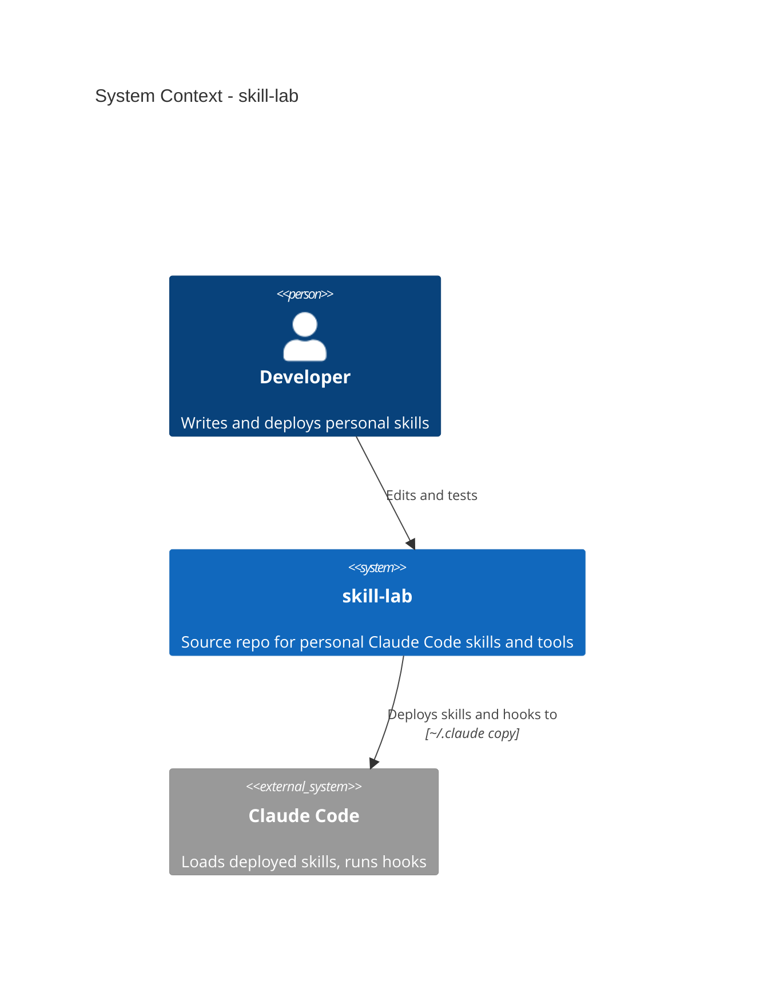
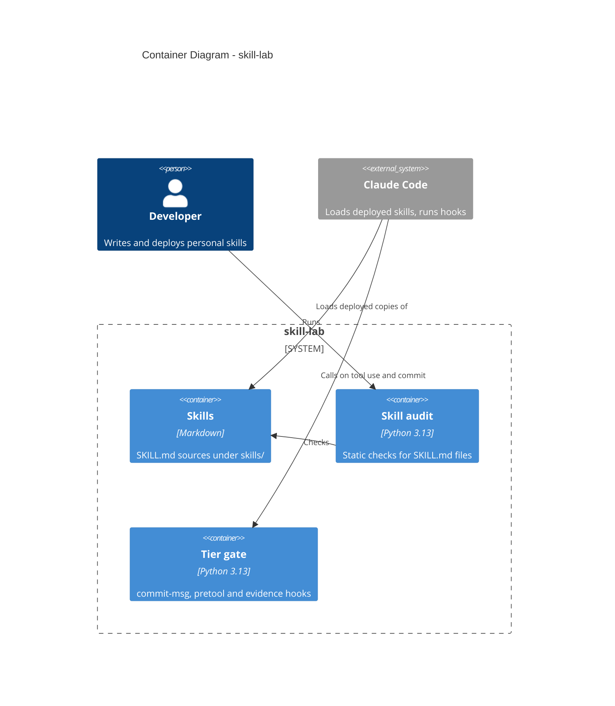

# skill-lab Architecture

## How to read this
Humans: diagrams and descriptions below. AI agents: the YAML in "AI structured data" lists every element and relation and is authoritative; `id` equals the Mermaid alias.

## 1. System Context

**Scope:** one developer, one repo, one consumer (Claude Code on this machine). Other plugins (superpowers, ponytail) are out of scope.
**Key decisions:** source of truth stays in this repo; `~/.claude` holds copies only (CLAUDE.md rule 8). Design: `docs/changes/2026-11-04-personal-workflow-design.md`.

## 2. Container

**Scope:** containers are the three things that are edited and shipped separately. Tests and docs are not shown.
**Key decisions:** the gate is one stdlib-only file so deployment is a single copy.

## AI structured data
```yaml
elements:
  - id: dev
    level: context
    type: person
    name: Developer
    description: Writes and deploys personal skills
  - id: claude
    level: context
    type: system_ext
    name: Claude Code
    description: Loads deployed skills, runs hooks
  - id: skilllab
    level: context
    type: system
    name: skill-lab
    description: Source repo for personal Claude Code skills and tools
    code: ./
  - id: skills
    level: container
    type: container
    name: Skills
    tech: Markdown
    description: SKILL.md sources under skills/
    behavior:
      - Each skill directory has a SKILL.md with name and description frontmatter
      - Imported third-party skills carry LICENSE and a SOURCE.md recording upstream commit, copied date and local modifications
      - web-visual-design holds graded colour, Chinese-Latin type and layout knowledge in references/; its procedure keeps the spec to the brief's length with working in an appendix
      - web-visual-design/scripts/palette_check.py checks tokens.json for WCAG 2.2 contrast on declared pairs; exits 0 pass, 1 problems, 2 unreadable or bad usage; empty pairs and malformed input are problems, not crashes
    code: skills/
    parent: skilllab
  - id: audit
    level: container
    type: container
    name: Skill audit
    tech: Python 3.13
    description: Static checks for SKILL.md files
    behavior:
      - Flags size, frontmatter limits, dangling references and body overlap
      - Exits 1 when any skill is flagged
      - "--json prints skills, flagged count and overlap pairs as JSON"
    code: tools/skill_audit.py
    parent: skilllab
  - id: gate
    level: container
    type: container
    name: Tier gate
    tech: Python 3.13
    description: commit-msg, pretool and evidence hooks
    behavior:
      - Only acts in repos with .agent-gate and for Claude sessions
      - Blocks commits whose Tier/Change trailers or change files fail the rules in skill change-record
    code: tools/gate.py
    parent: skilllab
relations:
  - from: dev
    to: skilllab
    label: Edits and tests
  - from: skilllab
    to: claude
    label: Deploys skills and hooks to
    protocol: ~/.claude copy
  - from: dev
    to: audit
    label: Runs
  - from: audit
    to: skills
    label: Checks
  - from: claude
    to: skills
    label: Loads deployed copies of
  - from: claude
    to: gate
    label: Calls on tool use and commit
```
